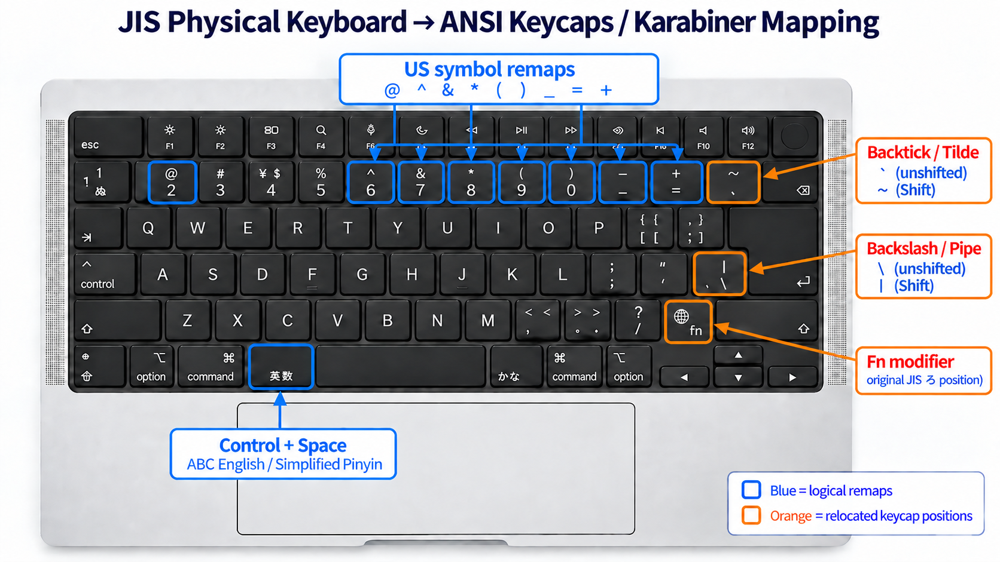

# JIS MacBook to ANSI US Keyboard Configuration

This is a Karabiner-Elements configuration for a **Japanese JIS physical keyboard with US ANSI keycaps**.

## Files

- `karabiner.json`: Karabiner-Elements configuration
- `README.md`: Chinese documentation and the default README
- `README.ja.md`: Japanese documentation

## Current setup

- Virtual keyboard type: ANSI
- Active profile: `Default profile`
- JIS symbol positions are mapped for the US layout
- The physical key in the original JIS `ろ` position, now wearing the Fn keycap, is mapped to Fn
- The `英数` key sends `Control + Space` to switch between ABC English and Simplified Pinyin

Fn is a modifier key, so pressing it by itself normally produces no visible character. Test it together with a function key or an arrow key.

## Detailed mappings

The following table describes the intended output for this keycap arrangement:

| JIS physical key or combination | Output |
| --- | --- |
| `Shift + 2` | `@` |
| `Shift + 6` | `^` |
| `Shift + 7` | `&` |
| `Shift + 8` | `*` |
| `Shift + 9` | `(` |
| `Shift + 0` | `)` |
| `Shift + -` | `_` |
| `^` | `=` |
| `Shift + ^` | `+` |
| `¥` position | `` ` `` |
| `Shift + ¥` / `|` | `~` |
| `@` position | `[` |
| `Shift + @` | `{` |
| `[` position | `]` |
| `Shift + [` | `}` |
| `Shift + ;` / `+` | `:` |
| `:` position | `'` |
| `Shift + :` / `*` | `"` |
| `]` position | `\` |
| `Shift + ]` | `|` |
| Original JIS `ろ` position | `Fn` |
| `英数` | `Control + Space`, switching between ABC English and Simplified Pinyin |

“Position” refers to the physical switch location, not the legend printed on the keycap. The physical position that now has the `` ` / ~ `` keycap was originally the JIS `¥` position; the position with the `\ / |` keycap was originally the JIS `]` position; and the position with the Fn keycap was originally the JIS `ろ` position.

## Installation

1. Install and open Karabiner-Elements.
2. Back up the existing configuration:

   `~/.config/karabiner/karabiner.json`

3. Copy this directory's `karabiner.json` to that location and replace the existing file.
4. Select **ANSI** in Karabiner-Elements → Virtual Keyboard.
5. Make sure Karabiner-Elements has Accessibility, Input Monitoring, and virtual keyboard permissions.
6. Test the symbol keys and the `英数` key with the ABC English or Simplified Pinyin input source.

## Notes

This configuration is tailored to one Japanese JIS MacBook keycap arrangement. It should not be copied unchanged to a standard ANSI keyboard or a different keyboard model. Back up the existing configuration and test the commonly used symbol keys after importing it.
