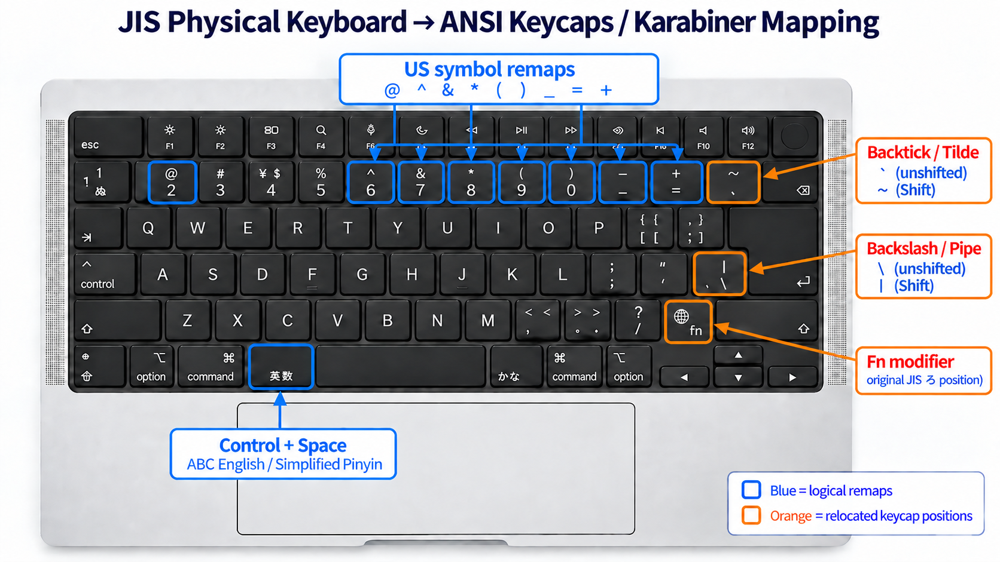

# JIS MacBook → ANSI 英語キーボード設定

これは、**日本語 JIS 物理キーボードに ANSI 英語配列のキーキャップを取り付けた MacBook** 向けの Karabiner-Elements 設定です。

## ファイル

- `karabiner.json`：Karabiner-Elements の設定ファイル
- `README.md`：中国語の説明（デフォルトの README）
- `README.en.md`：英語の説明

## 現在の設定

- 仮想キーボードの種類：ANSI
- 使用中のプロファイル：`Default profile`
- JIS の記号キーを ANSI 英語配列用に変換
- 元の JIS「ろ」キーの位置にある Fn キーキャップを Fn として使用
- 「英数」キーで `Control + Space` を送信し、ABC 英語入力と簡体字中国語ピンイン入力を切り替え

Fn は修飾キーなので、単独で押しても通常は画面上に文字が表示されません。ファンクションキーや矢印キーと組み合わせて確認してください。

## 詳細なマッピング

このキーキャップ配置で想定している出力は次のとおりです。

| JIS の物理キーまたは組み合わせ | 出力 |
| --- | --- |
| `Shift + 2` | `@` |
| `Shift + 6` | `^` |
| `Shift + 7` | `&` |
| `Shift + 8` | `*` |
| `Shift + 9` | `(` |
| `Shift + 0` | `)` |
| `Shift + -` | `_` |
| `^` | `=` |
| `Shift + ^` | `+` |
| `¥` の位置 | `` ` `` |
| `Shift + ¥` / `|` | `~` |
| `@` の位置 | `[` |
| `Shift + @` | `{` |
| `[` の位置 | `]` |
| `Shift + [` | `}` |
| `Shift + ;` / `+` | `:` |
| `:` の位置 | `'` |
| `Shift + :` / `*` | `"` |
| `]` の位置 | `\` |
| `Shift + ]` | `|` |
| 元の JIS `ろ` の位置 | `Fn` |
| 左矢印キーのすぐ左にある元の Fn キー | 右 Option（⌥、`right_option`） |
| `英数` | `Control + Space`。ABC 英語入力と簡体字中国語ピンイン入力を切り替え |
| スペースキーのすぐ右にある `かな` キー | 標準のかなキー（`japanese_kana`） |

ここでいう「位置」はキーキャップの印刷ではなく、キーボード上の物理スイッチの位置を指します。現在 `` ` / ~ `` キーキャップがある位置は元の JIS `¥` の位置、`\ / |` キーキャップがある位置は元の JIS `]` の位置、Fn キーキャップがある位置は元の JIS `ろ` の位置です。

## インストール

1. Karabiner-Elements をインストールして起動します。
2. 現在の設定ファイルをバックアップします。

   `~/.config/karabiner/karabiner.json`

3. このフォルダーの `karabiner.json` を上記の場所へコピーして置き換えます。
4. Karabiner-Elements の Virtual Keyboard で **ANSI** を選択します。
5. Karabiner-Elements にアクセシビリティ、入力監視、仮想キーボード関連の権限があることを確認します。
6. ABC 英語入力または簡体字中国語ピンイン入力で、記号キーと「英数」キーを確認します。

## 注意

この設定は、特定の日本語 JIS MacBook のキーキャップ交換状態に合わせています。通常の ANSI キーボードや別の機種へそのまま適用しないでください。インポート前に元の設定をバックアップし、よく使う記号キーを確認してください。
