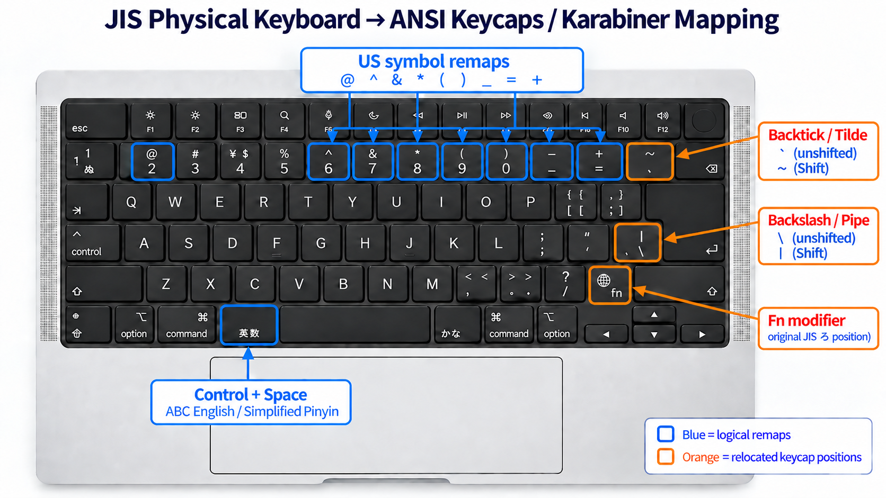

# JIS MacBook → ANSI 美式键盘配置

这是一个适用于 **日文 JIS 实体键盘 + 美式 ANSI 键帽** 的 Karabiner-Elements 配置。

## 文件

- `karabiner.json`：Karabiner-Elements 配置文件
- `README.en.md`：English documentation
- `README.ja.md`：日本語ドキュメント

## 当前设置

- 虚拟键盘类型：ANSI
- 默认配置：`Default profile`
- JIS 符号键映射为美式符号布局
- 换到原「ろ」物理位置的 Fn 键帽映射为 Fn
- 「英数」键触发 `Control + Space`，用于在 ABC 英文和简体拼音之间切换

Fn 是修饰键，单独按下通常不会产生可见字符；可以按住 Fn 再按功能键测试。

## 详细映射

以下是这套换键帽方案中的目标输出：

| JIS 物理键及组合 | 输出 |
| --- | --- |
| `Shift + 2` | `@` |
| `Shift + 6` | `^` |
| `Shift + 7` | `&` |
| `Shift + 8` | `*` |
| `Shift + 9` | `(` |
| `Shift + 0` | `)` |
| `Shift + -` | `_` |
| `^` | `=` |
| `Shift + ^` | `+` |
| `¥` 位置 | `` ` `` |
| `Shift + ¥` / `|` | `~` |
| `@` 位置 | `[` |
| `Shift + @` | `{` |
| `[` 位置 | `]` |
| `Shift + [` | `}` |
| `Shift + ;` / `+` | `:` |
| `:` 位置 | `'` |
| `Shift + :` / `*` | `"` |
| `]` 位置 | `\` |
| `Shift + ]` | `|` |
| 原 JIS `ろ` 位置 | `Fn` |
| `英数` | `Control + Space`，切换 ABC 英文和简体拼音 |

这里的“位置”指实体键盘上的物理位置，不是键帽上印刷的字符。顶部换成 `` ` / ~ `` 键帽的物理位置对应原 JIS `¥` 键；换成 `\ / |` 键帽的物理位置对应原 JIS `]` 键；换成 Fn 键帽的位置对应原 JIS `ろ` 键。

## 安装

1. 安装并打开 Karabiner-Elements。
2. 先备份现有配置文件：

   `~/.config/karabiner/karabiner.json`

3. 将本目录中的 `karabiner.json` 复制到上述位置并覆盖原文件。
4. 在 Karabiner-Elements 的 Virtual Keyboard 中选择 **ANSI**。
5. 确认 Karabiner-Elements 已获得辅助功能、输入监控和虚拟键盘相关权限。
6. 使用 ABC 英文或简体拼音输入法测试符号键和「英数」键。

## 注意

这个配置针对日文 JIS MacBook 的具体换键帽方案编写，不适合直接套用到普通 ANSI 键盘或其他型号。导入后请先备份原配置，并逐个测试常用符号键。
